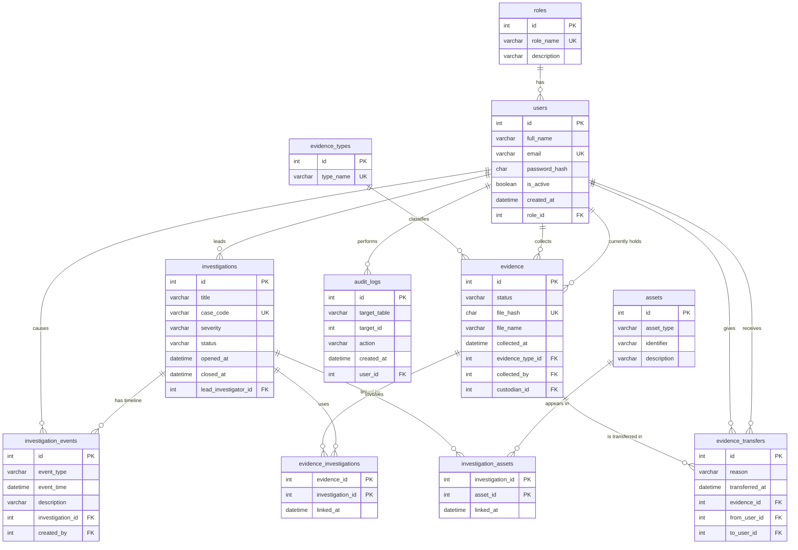
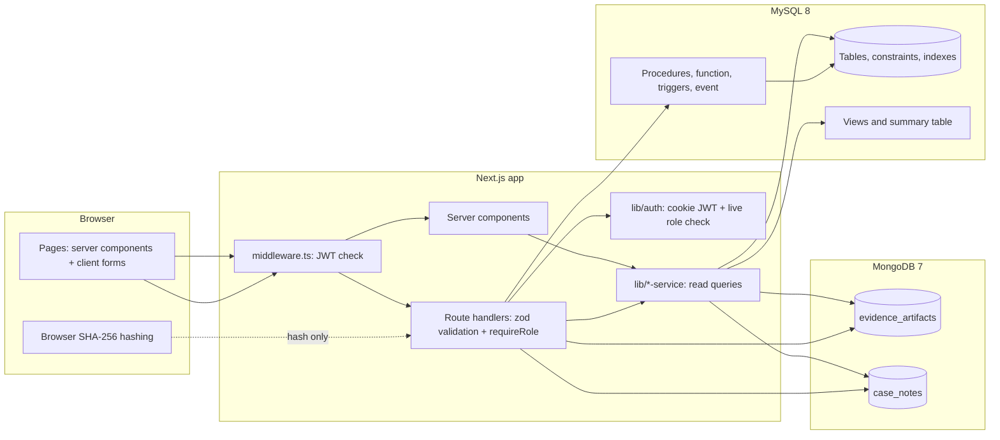

# ShadowTrace - Digital Evidence Forensics System
**DBMS Level 3 mini project report**

Team: Shreelakshmi G Bhat (PES2UG24CS478) - evidence and chain-of-custody module. Aniyath Amrita Pradeep (PES2UG24CS919) - authentication, investigations and dashboard module.

## 1. Problem statement
In a digital investigation, a single disk image, phone dump or network capture can decide a case. It can only be used in court if the investigating team can prove three things: **what** the item is (it has not been altered), **who** held it at every moment (an unbroken chain of custody), and **who did what** to the records about it (a tamper-proof audit trail). Today these facts are often scattered across spreadsheets, emails and personal notes, which makes custody gaps, duplicate evidence, lost context and silent edits easy.

ShadowTrace is a database-backed web system that keeps evidence records, custody transfers, investigations, linked assets (IPs, accounts, wallets) and investigator notes in one place, enforces the rules in the database itself, and records every change.

## 2. Objectives
1. Store evidence with a cryptographic fingerprint (SHA-256) that can be re-checked at any time.
2. Record every custody transfer atomically, so the current custodian and the history can never disagree.
3. Group evidence and assets into investigations and show how cases connect (shared assets and evidence).
4. Keep an append-only audit log of who changed what.
5. Give each person only the access their role needs (ADMIN, INVESTIGATOR, ANALYST).
6. Store flexible, per-evidence-type forensic metadata and free-form case notes without forcing them into rigid tables.
7. Demonstrate the database concepts of the course: ER design, constraints, indexes, views, transactions, procedures, triggers, full-text search, and a NoSQL store with aggregation.

## 3. Scope
**In scope:** user accounts and roles; evidence registration, status and custody; investigations with a timeline; evidence and asset linking; case notes; dashboards and statistics; audit log; search and filtering.
**Out of scope:** storing the evidence files themselves (only metadata and the hash are stored; the file is hashed in the browser and never uploaded), email notifications, multi-organisation tenancy, and legal-grade timestamping.

## 4. Functional requirements
| # | Requirement |
|---|---|
| F1 | Users log in with email and password; sessions expire after 8 hours; failed logins are rate-limited |
| F2 | Three roles: ADMIN manages users and sees everything; INVESTIGATOR leads cases, collects evidence and transfers custody; ANALYST adds artifact metadata and notes and cannot delete |
| F3 | Register evidence with file name, type and SHA-256 hash; reject duplicates and malformed hashes |
| F4 | Transfer custody only from the current custodian to an active user, with a reason; all-or-nothing |
| F5 | Verify a file against its stored hash in the browser |
| F6 | Open, edit, put on hold and close investigations; closing is restricted to the lead investigator or an admin; closed cases are frozen |
| F7 | Link and unlink evidence and assets to a case; each action appears on the case timeline |
| F8 | Search investigations with ranked full-text search (title and timeline), filter by status, severity and lead |
| F9 | Add, edit (with history) and delete investigator notes with tags, mentioned evidence and attachment metadata |
| F10 | Dashboards: case KPIs, workload per investigator, monthly trends, evidence statistics, note statistics |
| F11 | Admins manage users (create, change role, deactivate, reset password) and can read the audit log |
| F12 | Every write records the acting user in the audit log; the log cannot be edited or deleted |

## 5. System design

### 5.1 ER diagram

The summary table `monthly_case_stats` is derived data (rebuilt from `investigations`) and has no foreign keys, so it is not drawn. In MongoDB, `evidence_artifacts` points at `evidence.id` and `case_notes` points at `investigations.id`, `users.id` and `evidence.id`.

### 5.2 Relational schema
(PK underlined in the diagram above; `->` is a foreign key.)

- **roles**(id, role_name, description)
- **users**(id, full_name, email, password_hash, is_active, created_at, role_id -> roles)
- **evidence_types**(id, type_name)
- **evidence**(id, status, file_hash, file_name, collected_at, evidence_type_id -> evidence_types, collected_by -> users, custodian_id -> users)
- **evidence_transfers**(id, reason, transferred_at, evidence_id -> evidence, from_user_id -> users, to_user_id -> users)
- **audit_logs**(id, target_table, target_id, action, created_at, user_id -> users)
- **investigations**(id, title, case_code, severity, status, opened_at, closed_at, lead_investigator_id -> users)
- **investigation_events**(id, event_type, event_time, description, investigation_id -> investigations, created_by -> users)
- **assets**(id, asset_type, identifier, description) with UNIQUE(asset_type, identifier)
- **evidence_investigations**(evidence_id -> evidence, investigation_id -> investigations, linked_at), PK (evidence_id, investigation_id)
- **investigation_assets**(investigation_id -> investigations, asset_id -> assets, linked_at), PK (investigation_id, asset_id)
- **monthly_case_stats**(stat_month, cases_opened, cases_closed, critical_opened, avg_days_to_close, refreshed_at) - summary table

All tables are in third normal form: every non-key column depends on the key, the many-to-many relationships are resolved with junction tables, and lookups (roles, evidence types) are separate tables. Column-level rules are listed in the data dictionaries: [docs/core-module.md](core-module.md) for Member B's tables, and `db/sql/01_evidence.sql` for Member A's.

### 5.3 Why two databases
| Data | Database | Reason |
|---|---|---|
| Users, roles, evidence records, custody transfers, investigations, links, audit log | **MySQL** | Integrity-critical. Needs foreign keys (a transfer cannot reference a missing evidence item), CHECK/UNIQUE constraints (hash format, no duplicate evidence), transactions (a transfer inserts a row and changes the custodian, or neither), triggers (audit log, tamper protection) and row locks (two people cannot transfer the same item). These guarantees are what make records defensible in court |
| Forensic artifact metadata (`evidence_artifacts`) | **MongoDB** | The shape depends on the evidence type: a phone has an IMEI and apps, a disk has partitions, a capture has protocols and IP pairs, and new types will add unforeseen fields. In MySQL this needs EAV (loses types and constraints), dozens of mostly-NULL columns (needs an `ALTER TABLE` per new type), or a JSON column (no schema validation, awkward indexing). Mongo stores each as one document, validates it per type with `$jsonSchema`, and aggregates inside arrays with `$unwind` ([db/mongo/JUSTIFICATION.md](../db/mongo/JUSTIFICATION.md)) |
| Investigator notes (`case_notes`) | **MongoDB** | Free-form text with tags, mentioned evidence ids, attachments and an embedded edit history that must change atomically with the text ([docs/mongo-case-notes.md](mongo-case-notes.md)) |

Each Mongo document carries the MySQL key it refers to (`evidence_id`, `investigation_id`, `author_id`). Mongo cannot enforce those references, so the API verifies them in MySQL before writing.

### 5.4 Architecture

Reads for pages go straight from server components through the service modules (`lib/evidence-service.ts`, `lib/core-service.ts`) to the databases. Writes go through the route handlers, which validate input with zod, check the role, and use parameterised SQL. Multi-row writes run inside `withTransaction`, which sets `@app_user_id` so the audit triggers know who acted. Procedures that run their own transaction (`transfer_custody`, `close_investigation`, `refresh_monthly_case_stats`) are called on their own connection, because a nested `START TRANSACTION` would silently commit the outer transaction.

## 6. Database features demonstrated
| Feature | Where |
|---|---|
| ER design, relational schema, 3NF | sections 5.1-5.2 |
| DDL: CREATE, ALTER, DROP | `db/sql/00_core.sql`, `01_evidence.sql`, `02_links.sql`, `99_alter_drop_demo.sql` |
| Constraints: PK, FK (RESTRICT/CASCADE), UNIQUE, NOT NULL, CHECK, REGEXP | all table files |
| Indexes (single, composite, DESC, FULLTEXT, multikey) | data dictionaries |
| Views and a summary table | `v_evidence_current`, `v_chain_of_custody`, `v_case_overview`, `v_investigator_workload`, `monthly_case_stats` |
| Transactions and row locking | `transfer_custody`, `close_investigation`, `withTransaction` |
| Stored procedures and function | `transfer_custody`, `get_case_summary`, `close_investigation`, `refresh_monthly_case_stats`, `case_duration_days` |
| Triggers | 9 evidence/audit triggers, `trg_inv_au_status`, 2 user email triggers |
| Full-text search | FULLTEXT indexes + `MATCH ... AGAINST` on `/investigations` |
| DML with JOIN, GROUP BY, HAVING, ORDER BY, aggregates, subqueries, window functions, CTE | `db/queries/evidence_queries.sql`, `db/queries/core_queries.sql` |
| NoSQL with validation, indexes and aggregation | `db/mongo/*.ts` |
| Security: hashed passwords, env-based credentials, RBAC, input validation | [core-module.md](core-module.md) section 5 |

## 7. Important queries
Full sets (eight each, with comments): [db/queries/core_queries.sql](../db/queries/core_queries.sql) and [db/queries/evidence_queries.sql](../db/queries/evidence_queries.sql). Two examples, with results from the seed data:

**Assets that connect more than one investigation** (JOIN + GROUP BY + HAVING)
```sql
SELECT a.asset_type, a.identifier, COUNT(DISTINCT ia.investigation_id) AS cases_involved,
       GROUP_CONCAT(i.case_code ORDER BY i.case_code SEPARATOR ', ') AS case_codes
FROM assets a
JOIN investigation_assets ia ON ia.asset_id = a.id
JOIN investigations i        ON i.id = ia.investigation_id
GROUP BY a.id, a.asset_type, a.identifier
HAVING COUNT(DISTINCT ia.investigation_id) > 1
ORDER BY cases_involved DESC, a.identifier;
```
Returns seven shared assets, e.g. IP `203.0.113.45` in CASE-2025-002 and CASE-2025-003, and wallet `bc1q-example-ransom-0002` in CASE-2025-002 and CASE-2025-008.

**Average hours between custody events per evidence type** (CTE + window function; evidence module)
```sql
WITH gaps AS (
  SELECT e.evidence_type_id,
         TIMESTAMPDIFF(HOUR, LAG(tr.transferred_at, 1, e.collected_at)
                             OVER (PARTITION BY tr.evidence_id ORDER BY tr.transferred_at), tr.transferred_at) AS hours_gap
  FROM evidence_transfers tr JOIN evidence e ON e.id = tr.evidence_id)
SELECT t.type_name, COUNT(*) AS transfers, ROUND(AVG(g.hours_gap), 1) AS avg_hours_between
FROM gaps g JOIN evidence_types t ON t.id = g.evidence_type_id
GROUP BY t.id, t.type_name ORDER BY avg_hours_between DESC;
```

## 8. Evidence and chain-of-custody module (Member A)
The evidence module is documented by its own files rather than repeated here:
- Tables, constraints, indexes: [db/sql/01_evidence.sql](../db/sql/01_evidence.sql)
- `transfer_custody` procedure, audit and tamper-protection triggers, custody views: [db/sql/11_evidence_advanced.sql](../db/sql/11_evidence_advanced.sql)
- Seed data (25 evidence items, 40 transfers): [db/sql/91_seed_evidence.sql](../db/sql/91_seed_evidence.sql)
- Queries: [db/queries/evidence_queries.sql](../db/queries/evidence_queries.sql); test script: [db/tests/evidence_tests.sql](../db/tests/evidence_tests.sql)
- MongoDB artifact model and justification: [db/mongo/JUSTIFICATION.md](../db/mongo/JUSTIFICATION.md)
- Pages: `/evidence`, `/evidence/new`, `/evidence/[id]`, `/evidence/verify`, `/evidence/stats`, `/audit`

## 9. Implementation summary
Next.js 14 (App Router, TypeScript, Tailwind) with route handlers as the API; MySQL 8 through `mysql2/promise` with raw parameterised SQL (no ORM, so the SQL is visible); MongoDB 7 through the official driver; bcrypt, `jose` JWT in an httpOnly cookie; zod validation; recharts for charts. Credentials come only from environment variables. Docker Compose runs both databases, and one command (`npm run db:reset`) rebuilds the MySQL schema and seed data. Testing: [docs/testing-core.md](testing-core.md) for this module; `db/tests/evidence_tests.sql` for the evidence module.

## 10. Conclusion
ShadowTrace keeps the facts that must never be wrong (who holds the evidence, what its fingerprint is, who changed what) in MySQL, where the database itself refuses invalid states, and puts the variable, document-shaped material (artifact metadata and notes) in MongoDB, where flexibility matters more than joins. The result goes beyond create-read-update-delete: the important rules live in constraints, triggers, procedures and row locks, so they hold no matter which client writes the data.

## 11. Limitations and future enhancements
**Limitations**
- Login rate limiting is in-memory (single server only).
- Analysts see all cases and evidence; the schema has no "assigned to" relation.
- Hashing in the browser reads the whole file into memory; very large forensic images would need chunked hashing.
- `TRUNCATE` and `DROP` bypass the audit-log triggers unless database privileges are tightened for the application user.
- MongoDB references to MySQL ids are checked by the API, not by the database.

**Future enhancements**
- Assign analysts to specific cases and enforce it in queries.
- Store hash-chained audit entries (each row includes the hash of the previous one) for tamper evidence beyond triggers.
- Upload evidence to object storage and verify hashes server-side in streaming chunks.
- Redis-backed rate limiting and session revocation.
- Email or in-app notifications for custody transfers and case status changes.
- Export of a case file (timeline, custody chain, evidence list) as a PDF for court.
